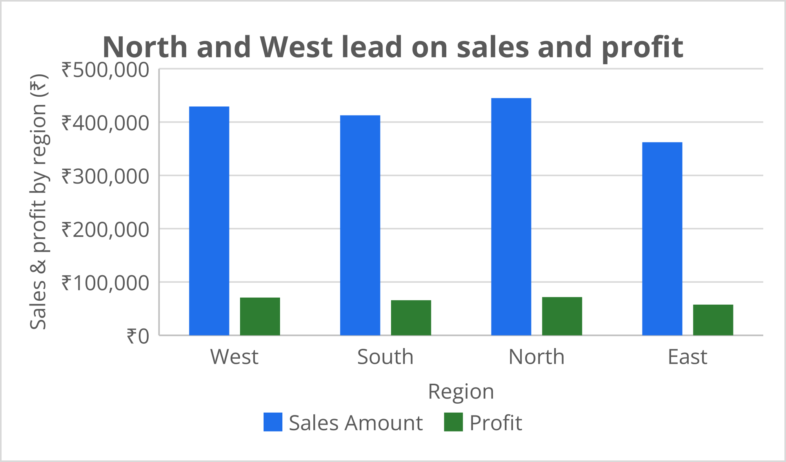
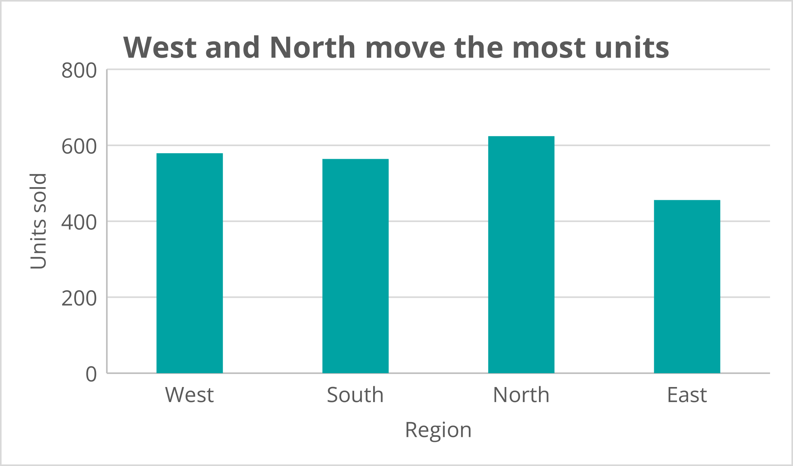
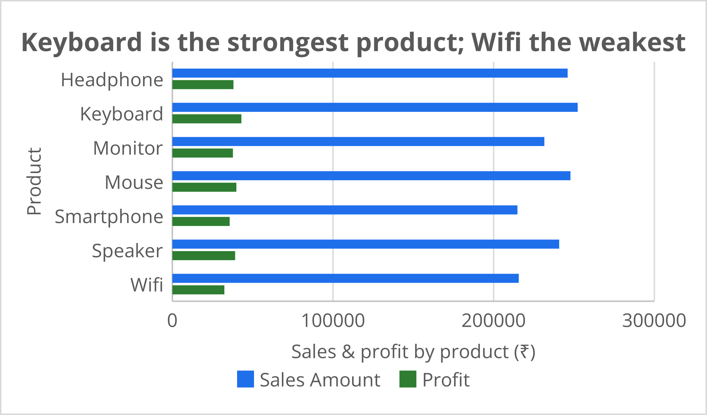
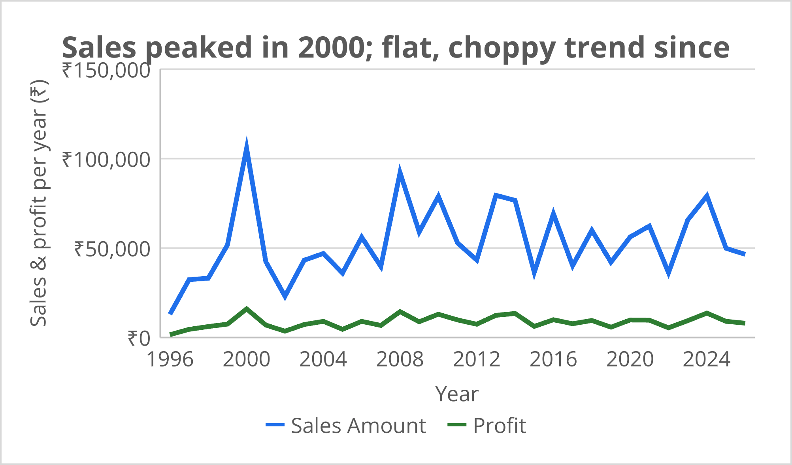

# 📊 Excel Sales Dashboard

An Excel-based sales analysis project that turns 500 raw sales records into a clear summary of **what sells, where it sells, and how profitable it is** — using Excel Tables, summary tables and charts.


---

## 🎯 Project Objective

Answer four basic business questions from the sales data:

1. Which **region** earns the most sales and profit?
2. Which **product** performs best and which performs worst?
3. How have **sales and profit changed over the years**?
4. Where are the **units** actually being sold?

---

## 📁 Repository Structure

```
excel-sales-dashboard/
├── Sales_Data.xlsx      # Raw data (Sheet1) + summary tables & charts (Sheet2)
├── images/              # Dashboard chart screenshots used in this README
└── README.md
```

---

## 🗂️ Dataset Overview

**Sheet1** holds the raw data as an Excel Table (`Table1`) with **500 rows × 11 columns**.

| Column | Description |
|---|---|
| `S.NO.` | Serial number of the sale |
| `Sales Date` | Date of the sale (1996 – 2026) |
| `Customer Name` | Name of the customer |
| `City` | City of the customer (261 unique) |
| `States` | State of the customer (28 unique) |
| `Region` | North / South / East / West |
| `Product Name` | Mouse, Keyboard, Headphone, Speaker, Monitor, Wifi, Smartphone |
| `Qunatity` | Units sold per order *(column name spelled as in the source file)* |
| `Price Per Unit` | Price of one unit (₹) |
| `Sales Amount` | Sales value of the order (₹) |
| `Profit` | Calculated column → `=Sales Amount − Price Per Unit` |

> **Note:** This is a practice / sample dataset created for learning purposes. Some city–state–region combinations do not match real-world geography, so the findings below describe this dataset only — not real market behaviour.

**Sheet2** holds the summary tables (by Region, by Product, by Year) and the four charts.

---

## 🛠️ Excel Skills Used

- Excel **Tables** (structured data)
- **Calculated columns** (Profit, Margin %)
- **Summary tables** by Region, Product and Year
- **Column, bar and line charts** with insight-style titles
- Data formatting with the ₹ currency format

---

## 📈 Key Numbers

| Metric | Value |
|---|---|
| Total Sales | **₹16,49,047** |
| Total Profit | **₹2,65,868** |
| Total Units Sold | **2,223** |
| Overall Profit Margin | **~16.1%** |

---

## 🔍 Dashboard & Insights

### 1. Sales & Profit by Region


| Region | Sales (₹) | Profit (₹) | Units | Margin % |
|---|---|---|---|---|
| North | 4,45,026 | 71,656 | 624 | 16.1% |
| West | 4,29,080 | 70,768 | 579 | 16.5% |
| South | 4,12,720 | 65,809 | 564 | 15.9% |
| East | 3,62,221 | 57,635 | 456 | 15.9% |

**Insight:** North and West lead on both sales and profit. East is the weakest region on every measure.

### 2. Units Sold by Region


**Insight:** North sells the most units (624), followed by West (579). East sells the fewest (456).

### 3. Sales & Profit by Product


| Product | Sales (₹) | Profit (₹) | Units | Margin % |
|---|---|---|---|---|
| Keyboard | 2,52,327 | 43,009 | 359 | 17.0% |
| Mouse | 2,47,835 | 39,863 | 313 | 16.1% |
| Headphone | 2,46,038 | 38,064 | 314 | 15.5% |
| Speaker | 2,40,789 | 39,089 | 318 | 16.2% |
| Monitor | 2,31,588 | 37,731 | 299 | 16.3% |
| Wifi | 2,15,639 | 32,413 | 342 | 15.0% |
| Smartphone | 2,14,831 | 35,699 | 278 | 16.6% |

**Insight:** Keyboard is the strongest product (highest sales, profit and margin). Wifi is the weakest on profit and margin, even though it sells a healthy number of units.

### 4. Yearly Sales Trend


**Insight:** Sales peaked in **2000 (₹1,05,784)**. Since then the trend has been flat and choppy, moving up and down without sustained growth. Profit follows the same shape at a much lower level.

---

## 💡 Recommendations

- **Focus on North and West** — they bring in the most sales and profit.
- **Investigate East** — find out whether the gap is caused by fewer customers, lower order sizes or weak marketing.
- **Promote Keyboards** — best margin and best sales, so push it in bundles with Mouse.
- **Review Wifi pricing / costs** — it has the lowest margin of all products.
- **Study the yearly dips** (e.g., 2002, 2015, 2022) to find out whether they are seasonal or caused by specific events.

---

## ▶️ How to Use This Repo

1. Clone the repository:
   ```bash
   git clone https://github.com/Rehan2641/excel-sales-dashboard.git
   ```
2. Open `Sales_Data.xlsx` in Microsoft Excel.
3. Go to **Sheet1** to see the raw data and **Sheet2** to see summary tables and charts.

---

## 🚀 Future Improvements

- Add **PivotTables and Slicers** for interactive filtering
- Add a **KPI cards** section at the top of the dashboard
- Build the same dashboard in **Power BI** and **Tableau**
- Repeat the analysis in **Python (pandas)** and **MySQL** and compare results

---

## 👤 Author

**Rehan**
BCA Data Science student, IMT College, Faridabad
🔗 GitHub: [@rehan2641](https://github.com/rehan2641)

⭐ If you found this project useful, feel free to star the repo!
